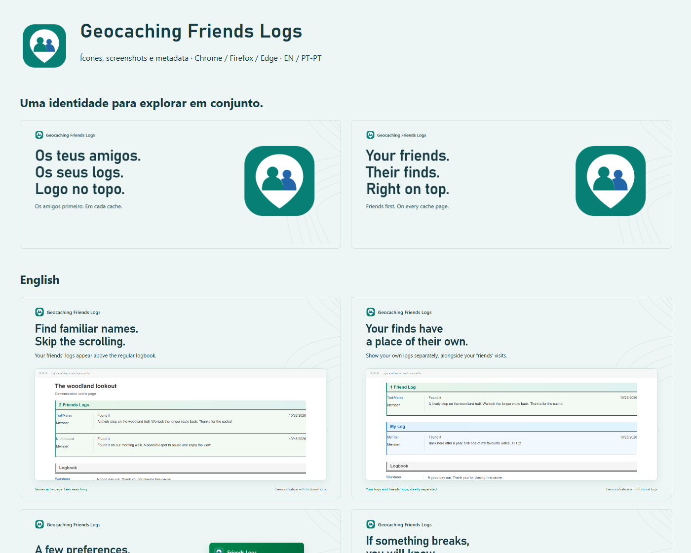

# Store visual kit

Artwork and listing copy prepared for version 2.7.0 from commit `434a18e7965de207fbb579dabfcaaf455d63dd8e`. Integration does not publish to any store. The canonical listing text remains in `../locales/`; the JSON in `metadata/` is a reviewed export snapshot.



## Upload files

| Purpose | Chrome | Firefox | Edge |
| --- | --- | --- | --- |
| Icon | [128 px, padded](icons/chrome-store-128.png) | [64 px](icons/icon-64.png) | [300 px](icons/icon-300.png) |
| Screenshots | `screenshots/en/` or `screenshots/pt-PT/` | Same files | Same files |
| Small promo | `promo/<locale>/440x280.png` | Not applicable | Same files |
| Large promo | `promo/<locale>/1400x560.png` | Not applicable | Same files |

Use screenshots in numeric order. Each is 1280 × 800. Promo images and screenshots are opaque PNGs; icons have transparency. The Chrome store icon has 16 px transparent padding on each side. The SVG master and PNG sizes from 16 through 1024 px are included. The new mark is original artwork, not the official Geocaching symbol.

- [English gallery](screenshots/en/)
- [Portuguese gallery](screenshots/pt-PT/)
- [Editable gallery](index.html) (open locally after cloning)
- [Reviewer notes](metadata/reviewer-notes.txt)
- [Permission notes](metadata/privacy-and-permissions.md)

## Capture provenance

Screenshots use the extension's actual popup and injected rendering code, with repository test fixtures and fictional logs. The surrounding cache page is a reduced fixture, not a full live-site capture. Headlines and browser frames are promotional composition. The popup uses the new icon. No personal accounts, credentials or real logs appear. Original captures are in `captures/`.

## Edit and reproduce

`source/icon-master.svg` is the vector original; `source/design.json` records the palette and typefaces. Editable HTML compositions use relative paths. Bahnschrift and Segoe UI are system fonts on Windows and are not redistributed; fallback fonts can change layouts on other systems.

From the repository root, after `npm ci` and `npx playwright install chromium`:

```sh
node store-listing/design/source/generate.cjs .
npm run store-listing:check
npm run store-listing:build
npm run build:all
```

The generator writes to this design folder. To reproduce this exact snapshot, use the source commit above; later runtime changes can alter the captures. After rendering, review the output and copy the approved screenshots to `../assets/` using the filenames referenced by `../locales/`. Copy selected icons to the runtime `icons/` folder and promotional assets to `../assets/` as needed. Update `asset-manifest.json` and validation records when replacing exported images.

`metadata/` files are editable export snapshots; they are not read by release jobs. Keep summaries in `../locales/` and `_locales/` synchronized. The privacy policy URL is intentionally unset in the snapshot: confirm the actual public URL in the store dashboard. The extension support URL points to its existing GitHub issues page.

## Specifications

- [Chrome image specifications](https://developer.chrome.com/docs/webstore/images)
- [Firefox listing guidance](https://extensionworkshop.com/documentation/develop/create-an-appealing-listing/)
- [Edge publishing guidance](https://learn.microsoft.com/en-us/microsoft-edge/extensions/publish/publish-extension)
